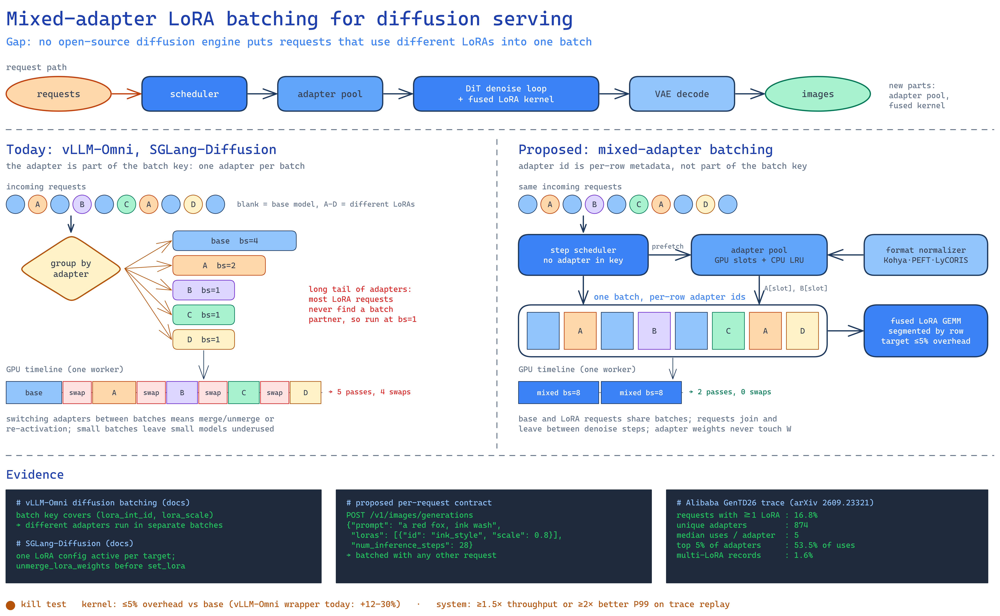
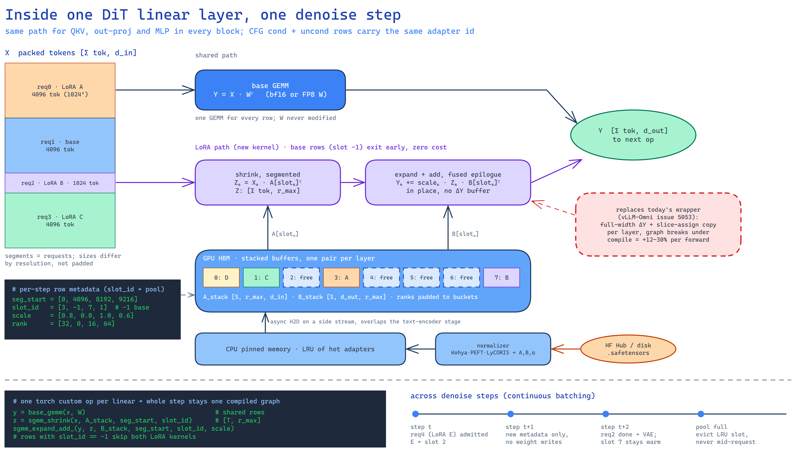
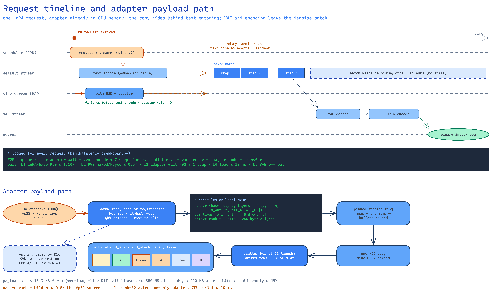

# HANDOFF — Mixed-adapter LoRA batching for diffusion serving

Working name: **`loramux`** (rename freely).
Owner: Avaya (OnePunchMonk). Executor: coding agent.
Diagrams: in this bundle under `docs/` (PNG to read, SVG for docs, `.excalidraw` to edit at excalidraw.com). Copy `docs/` into the repo as is.

---

## 0. Mission in one paragraph

Open-source diffusion serving engines (vLLM-Omni, SGLang-Diffusion) cannot put requests that use **different LoRA adapters** into the same batch. vLLM-Omni puts the adapter identity in the batch key; SGLang-Diffusion keeps one LoRA configuration active per model. Build a library that lets one batch carry a different adapter (or none) per row, using an **unmerged, segmented LoRA kernel** plus a **GPU adapter pool**. First prove the idea is worth it with a cheap, pre-registered kill test. Only if it passes, build the library and a vLLM-Omni integration branch.

**Deliverables, in order:**
1. `RESULTS_killtest.md` with GO / GREY / NO-GO verdict against the pre-registered bars in §5.
2. (If GO or GREY) the `loramux` package with tests and benchmarks, plus `RESULTS_latency.md` covering the payload and latency work (§11).
3. (If GO) a local vLLM-Omni branch that enables mixed batching behind a flag, plus a drafted PR description and a drafted comment for vLLM-Omni RFC #6239. **Do not push, open PRs, or post comments. The owner does that.**

**Hard budget:** ≤ 200 USD of GPU total. Phase 1 (kill test) ≤ 25 USD. Use Modal, 1× H100 80GB. Log the spend after every run in `SPEND.md`.

---

## Diagrams (read these before the text)

**HLD — system view.** Today's adapter-keyed batching against the proposed mixed batching, plus the evidence and the kill-test bars.



**LLD — one DiT linear layer, one denoise step.** Packed tokens and row metadata, the shared base GEMM, the segmented shrink and in-place expand-add, the adapter pool tiers, the custom-op pseudocode, and admit/evict across steps. Detail in §3.



**Payload and latency (§11).** Per-request stream timeline (adapter copy hidden behind text encoding; VAE and encoding off the denoise path), the logged latency breakdown, and the adapter payload path from Hub file to GPU slot.



Where the text and a diagram disagree, **the text wins**. Report the mismatch.

---

## 1. Verified context (do not re-research; do re-check versions)

| Fact | Source |
|---|---|
| vLLM-Omni request-level batching: "Requests with different LoRA adapters or scales are kept in separate batches so the worker activates one adapter per batch." | https://docs.vllm.ai/projects/vllm-omni/en/latest/user_guide/diffusion/request_batching/ |
| vLLM-Omni step-wise continuous batching key "covers LoRA identity (`lora_int_id`, `lora_scale`)" | https://docs.vllm.ai/projects/vllm-omni/en/stable/design/feature/diffusion_continuous_batching/ |
| vLLM-Omni diffusion LoRA: LRU-cached adapters, per-request `LoRARequest`, PEFT + "Distill" backends, multi-LoRA *composition* = one adapter with summed rank; Kohya single-file supported (PR #4890) | https://docs.vllm.ai/projects/vllm-omni/en/latest/user_guide/diffusion/lora/ |
| vLLM-Omni unmerged LoRA path costs +12.4% / +19.8% / +29.9% at 1024 / 4096 / 16384 tokens (40-layer linear chain, dim 3584, bf16, RTX 4090). The cost is memory traffic: a full-width delta and a slice-assign copy per layer, plus graph breaks under `torch.compile`. Their fix is single-adapter merge-on-load. | https://github.com/vllm-project/vllm-omni/issues/5053 |
| vLLM-Omni RFC on production diffusion LoRA serving: adapter-aware batching is **out of scope**, no owner, asks for workload data. | https://github.com/vllm-project/vllm-omni/issues/6239 |
| SGLang-Diffusion: one LoRA config active per target; switching = `unmerge_lora_weights` then `set_lora`. PR #44955 ("multiple dynamic LoRA") is *stacking* in one workflow, still a draft. | https://docs.sglang.io/docs/sglang-diffusion/api/openai_api , https://github.com/sgl-project/sglang/pull/44955 |
| Production trace (Alibaba "GenTD26", 24 days): 16.8% of requests carry ≥1 LoRA; 1.6% of records carry several; 874 unique adapters; median adapter used 5 times; top 5% of adapters = 53.5% of uses; Gini 0.749; first adapter adds ~66% latency. Data/code on Gitee (link in paper). | https://arxiv.org/pdf/2609.23321 |
| Prior system: Katz (ATC'25) overlaps LoRA *loading* with compute; it does not batch mixed adapters. | https://github.com/modelscope/Katz |
| LLM-side prior art for the kernel: Punica SGMV, S-LoRA, and vLLM's Triton LoRA ops (`lora_shrink` / `lora_expand`; locate them under `vllm/lora/ops/` in the installed version) | https://github.com/punica-ai/punica |

**Implication:** the kernel idea exists for LLMs. What's missing is the diffusion integration: DiT shapes, CFG, compile-safety, the adapter-format zoo, and the scheduler. Reuse LLM kernels if they meet the bars (§5, baseline B5).

---

## 2. High-level design

### 2.1 Components
See the HLD diagram (`docs/hld.png`).

```
client ──► scheduler ──► adapter pool ──► DiT denoise loop (MuxLinear + loramux ops) ──► VAE ──► image
              │              ▲
              │ prefetch ids │ normalized A,B
              └──────────────┤
                       format normalizer ◄── HF Hub / disk (.safetensors)
```

| Component | Responsibility | Lives in |
|---|---|---|
| **Format normalizer** | Turn any supported LoRA file into canonical per-module `(A[r,d_in], B[d_out,r])` with `alpha/r` folded into B, keyed by the *engine's* module names. Handles fused-QKV layouts. | `loramux/formats/` |
| **Adapter pool** | Per-layer stacked GPU buffers with S slots; CPU pinned LRU tier; async host-to-device (H2D) prefetch; reference counting; eviction. | `loramux/pool.py` |
| **Batch metadata builder** | Per step: map batch rows (after CFG duplication) to `(slot, scale)`, build tile metadata for the kernels. | `loramux/metadata.py` |
| **MuxLinear** | Drop-in wrapper for `nn.Linear` (or the engine's linear class): `y = base(x)`, then the in-place LoRA apply from the current batch metadata. | `loramux/layers.py` |
| **Kernels** | Segmented shrink, segmented expand-add (v1); fused base GEMM + LoRA epilogue (v2, stretch). Registered as `torch.library` custom ops. | `loramux/ops/` |
| **Scheduler policy** | Batch key **excludes** adapter identity. Admit a request into the step batch only when its adapter is resident (prefetch event complete). | Own `bench/serve_loop.py` (Phase 1–2); vLLM-Omni scheduler (Phase 3) |

### 2.2 Request contract (proposed)

```json
POST /v1/images/generations
{"prompt": "a red fox, ink wash",
 "loras": [{"id": "ink_style", "scale": 0.8}],
 "num_inference_steps": 28, "width": 1024, "height": 1024, "seed": 7}
```
- `loras` may be empty (base model), hold one entry (the 98% case), or hold several. Several adapters become one composite adapter, cached by `(sorted ids, scales)`.
- In vLLM-Omni this maps onto the existing `LoRARequest`. Don't invent a new public API there.

### 2.3 Control flow per request

1. Request arrives → scheduler calls `pool.ensure_resident(adapter_key)`. That call is non-blocking and returns an event.
2. While the text encoder runs, the adapter streams CPU pinned → GPU slot on a side CUDA stream.
3. At the next step boundary, the scheduler admits every request whose event is complete into the running step batch, mixed adapters included. Batch key = (model, resolution bucket, num_steps policy, CFG on/off). **Not the adapter.**
4. Each denoise step: `metadata.build(rows)` → one forward pass of the DiT. Every MuxLinear applies the per-row LoRA.
5. When a request finishes, it leaves the batch → VAE → slot refcount is decremented. Slots with refcount 0 become evictable (LRU).

### 2.4 Non-goals for v1
- Tensor parallelism / sequence parallelism with LoRA (single GPU only).
- LoKr / LoHa / DoRA executed natively. v1: reject them, or materialize ΔW then truncated SVD to rank ≤ R_max behind a flag, with the reconstruction error logged.
- ControlNet / IP-Adapter.
- Mixed resolutions inside one batch (the kernel supports variable segments; the scheduler buckets by resolution).
- Training.

---

## 3. Low-level design
See the LLD diagram (`docs/lld.png`).

### 3.1 Shapes and notation
- DiT linear input `x`: `[Bt, N, d_in]`. `Bt` = rows after CFG duplication, N = tokens per row for this linear (image or text stream). Flatten to `X: [T, d_in]`, `T = Bt·N`.
- Segment = contiguous token range with one adapter. v1: one segment per row, so `seg_start[i] = i·N`. The kernels also accept arbitrary `seg_start` / `seg_len` (varlen packing).
- Pool: `S` slots, rank cap `R_max` (default 64; configurable bucket ∈ {16, 32, 64, 128}).
- Per layer ℓ: `A_stack[ℓ]: [S, R_max, d_in]`, `B_stack[ℓ]: [S, d_out, R_max]`, dtype bf16. Unused rank rows/cols are zero.
- Per slot: `rank[S]` (int32). Per segment: `slot_id[nseg]` (int32, −1 = base model), `scale[nseg]` (fp32, request strength).

### 3.2 Scale semantics (get this right; it's a common bug)
`ΔW = strength · (alpha / r) · B·A`. The normalizer folds `alpha/r` into B **once**, and the runtime `scale` is the user strength only. Match diffusers' `set_adapters(..., adapter_weights=strength)` semantics exactly, and test against diffusers (§6). vLLM-Omni documents a scale-convention gotcha (its `lora_scale` interacts with alpha/r). Write a test that pins your convention.

### 3.3 Fused projections (QKV etc.)
If the engine fuses `to_q, to_k, to_v` into one linear (output `[d_q | d_k | d_v]`), compose at load time:
- `A_fused = concat([A_q; A_k; A_v], dim=0)` → rank `3r`
- `B_fused = blockdiag(B_q, B_k, B_v)` → `[d_q+d_k+d_v, 3r]`

The kernel stays unaware of fusion. Make sure `3r ≤ R_max_fused`; pick that layer's `R_max` from the composed rank. The same trick composes multi-LoRA requests: concatenate A along rank; B = `[s1·B1 | s2·B2]`, with each adapter's own scale folded in. The composite is cached as its own slot.

### 3.4 Kernel v1 — segmented shrink + segmented expand-add (Triton)

**Tile metadata** (built on GPU each step from `seg_start, seg_len, slot_id`, no host sync):
- `BM` = row-tile height. Each segment s contributes `ceil(len_s / BM)` tiles.
- Arrays: `tile_seg[n_tiles]`, `tile_row0[n_tiles]`, `tile_row_end[n_tiles]`.
- Each tile lies entirely inside one segment, so it reads exactly one adapter. Waste is at most `BM−1` rows per segment, which is negligible at N ≥ 1024.

**Shrink:** `Z[T, R_max] = X · A_stack[slot]ᵀ` per tile.
```
grid = (n_tiles,)
pid → s = tile_seg[pid]; slot = slot_id[s]; if slot < 0: return
r = rank[slot]; RB = round_up(r, 16)        # loop only over live rank
acc[BM, RB] = 0 (fp32)
for k in range(0, d_in, BK):
    xt = load X[tile_row0:tile_row_end, k:k+BK]   (mask rows)
    at = load A_stack[slot, :RB, k:k+BK]
    acc += xt @ atᵀ
store Z[rows, :RB] = acc (fp32 or bf16; start with fp32, measure)
```

**Expand-add (in place):** `Y[rows, n-tile] += scale[s] · Z[rows, :RB] · B_stack[slot, n-tile, :RB]ᵀ`
```
grid = (n_tiles, cdiv(d_out, BN))
same early exit for slot < 0
z = load Z[rows, :RB]; b = load B_stack[slot, n0:n0+BN, :RB]
acc = (z @ bᵀ) * scale[s]                    # K = RB ≤ 128 → single K pass
y = load Y[rows, n0:n0+BN]; store Y = y + acc (bf16)
```
- Autotune on `(d_in, d_out, R_max)`: BM ∈ {64, 128}, BN ∈ {64, 128, 256}, BK ∈ {32, 64}, warps ∈ {4, 8}, stages ∈ {3, 4}.
- **Grouped shrink (optimization):** linears that consume the *same* X (q, k, v; FLUX single-stream `linear1`) share one shrink with A concatenated along rank. That reads X once per group.

### 3.5 Kernel v2 (stretch, only if v1 misses the bar) — expand fused into the base GEMM epilogue
A Triton GEMM computing `Y = X·Wᵀ + scale_s · Z_s·B[slot_s]ᵀ` in one pass. Per M-tile (single segment), after the K-loop over `W`, load `Z` tile `[BM, RB]` and `B[slot]` tile `[BN, RB]`, then do one extra small MMA in registers before the store. This removes the Y read-modify-write. bf16 only. FP8 base is out of scope.

### 3.6 Why these targets (roofline, H100; verify by measurement)
Let `F/BW ≈ 230` (achievable bf16 FLOP/s ÷ achievable HBM B/s). For one linear with T tokens, the v1 overhead relative to the base GEMM is:
- Y read-modify-write: `(F/BW)·(2/d_in)`
- shrink reading X: `(F/BW)·(1/d_out)` (amortized by grouped shrink)

| linear (d_in → d_out) | v1 (RMW) | v2 (fused epilogue) |
|---|---|---|
| 3072 → 3072 | ≈ 22% | ≈ 7.5% |
| 3072 → 9216 (QKV) | ≈ 17% | ≈ 2.5% |
| 3072 → 12288 (MLP up) | ≈ 17% | ≈ 2% |
| 12288 → 3072 (MLP down) | ≈ 11% | ≈ 7.5% |

The end-to-end step overhead is lower because attention (SDPA) and non-targeted linears dilute it. Most diffusion LoRAs target attention projections only. **Report both per-linear and end-to-end numbers.** If v1 per-linear is > 1.3× its roofline value above, profile with `ncu` before anything else.

### 3.7 MuxLinear and the context

```python
# loramux/context.py
@dataclass
class BatchLoRAMeta:
    seg_start: torch.Tensor   # int32 [nseg], device
    seg_len:   torch.Tensor   # int32 [nseg]
    slot_id:   torch.Tensor   # int32 [nseg], -1 = base
    scale:     torch.Tensor   # fp32  [nseg]
    tiles:     TileMeta       # built once per step per BM config
    any_lora:  bool           # host-side flag, computed when the batch is formed (no sync)

@contextmanager
def lora_batch(meta: BatchLoRAMeta): ...      # sets a module-level current meta
def current() -> BatchLoRAMeta | None: ...

# loramux/layers.py
class MuxLinear(nn.Module):
    def __init__(self, base: nn.Linear, layer_key: str, pool: "AdapterPool"): ...
    def forward(self, x):
        y = self.base(x)
        m = current()
        if m is None or not m.any_lora or not self.pool.has_layer(self.layer_key):
            return y
        A, B, rank = self.pool.buffers(self.layer_key)
        torch.ops.loramux.lora_apply_(y.view(-1, y.shape[-1]), x.view(-1, x.shape[-1]),
                                      A, B, rank, m.slot_id, m.scale, m.tiles)
        return y

def patch_model(model, target_patterns: list[str], pool) -> list[str]:
    """Replace matching linears with MuxLinear; return the layer keys."""
```

- Register `loramux::lora_apply_` with `torch.library.custom_op(..., mutates_args=("y",))` and a `register_fake`. Acceptance: `torch.compile(transformer)` produces **no new graph breaks** (check with `TORCH_LOGS=graph_breaks`).
- CUDA graphs: v1 no. v2: fixed-capacity metadata buffers updated in place before replay.
- CFG: the metadata builder takes per-request `(slot, scale)` plus the pipeline's row layout (`[cond…, uncond…]` or interleaved) and emits per-row metadata. Unit-test both layouts.

### 3.8 Adapter pool

```python
class AdapterPool:
    def __init__(self, layer_shapes: dict[str, tuple[int,int]], slots: int, r_max: int,
                 cpu_capacity_bytes: int, device="cuda"): ...
    def register(self, adapter_key: str, tensors: CanonicalAdapter) -> None   # CPU pinned tier
    def ensure_resident(self, adapter_key: str) -> torch.cuda.Event          # async, side stream
    def acquire(self, adapter_key: str) -> int        # slot id; refcount += 1; must be resident
    def release(self, adapter_key: str) -> None       # refcount -= 1
    def buffers(self, layer_key: str) -> tuple[Tensor, Tensor, Tensor]  # A_stack, B_stack, rank
    def stats(self) -> dict                           # hits, misses, evictions, h2d bytes/ms
```
- Memory per slot = `Σ_layers R_max·(d_in + d_out)·2 B`. Log it at init for the chosen model and R_max. Pick S from the GPU memory left after the model and activations.
- Eviction: LRU among slots with refcount 0. Never evict mid-request. If no slot is free, the request waits in the queue (counts toward latency in benchmarks).
- H2D: **one bulk copy per adapter, not one per tensor.** The CPU tier stores each adapter as a single contiguous pinned blob in the layout of §11.1. One `copy_(non_blocking=True)` moves it into a GPU staging buffer on a dedicated stream. A small scatter kernel then writes it into the per-layer slot rows. The event is recorded and checked with `event.query()` by the scheduler, so there is no blocking sync. (Per-tensor copies would mean ~1000 small `cudaMemcpyAsync` calls per adapter, each costing launch latency.)
- Disk → CPU (normalizer) runs in a thread pool. Measure its latency separately and report it. Don't hide it.

### 3.9 Format normalizer
- Inputs v1: diffusers/PEFT (`lora_A`/`lora_B`), Kohya (`lora_down`/`lora_up` + `alpha`), ComfyUI prefixes (`diffusion_model.`), `transformer.` prefix.
- Output: `CanonicalAdapter = {engine_module_key: (A[r,d_in] bf16, B[d_out,r] bf16 with alpha/r folded)}` + metadata (base model id, rank per module, source format, sha256).
- Per-model key maps in `formats/keymaps/<model>.py`. Start from diffusers' own LoRA conversion utilities (they already map Kohya/ComfyUI keys for FLUX/Qwen-Image; locate them in the installed diffusers), rather than re-deriving.
- **Fail loud:** if any LoRA tensor maps to no engine module, raise (vLLM-Omni had silent no-op bugs: issues #7190, #8001). Report coverage: matched / total keys.

---

## 4. Phases

### Phase 0 — Setup (≤ 1 h, CPU)
1. Repo skeleton (§8). `modal_app.py` with an H100 image: pinned torch (CUDA 12.x), triton, diffusers (pinned), safetensors, plus vllm-omni at its latest release (pinned; record the version).
2. Pick models: **Qwen-Image** (vLLM-Omni supports it; the baseline must run there) and **FLUX.2 Klein 4B** for the small-model regime, if diffusers supports it in the pinned version. Read their configs and log `d_model`, layer count and the linear shapes.
3. Adapters:
   - **Correctness set:** 4–8 real public LoRAs per base model from HF Hub, at least 2 formats (diffusers + Kohya/ComfyUI).
   - **Perf set:** 64 synthetic adapters per model: ranks drawn from {8, 16, 32, 64}; targets attention-only for half, all-linear for half; `A ~ N(0, 1/d_in)`, `B ~ N(0, 1e-2)`.

### Phase 1 — Kill test (≤ 25 USD)
**K1 correctness:** §6 tests on Qwen-Image or Klein, 16 prompts × 4 real adapters.

**K2 kernel performance:**
- (a) **Linear-chain microbench**, matching issue 5053: 40 linears, dim = model d_model, bf16, tokens ∈ {1024, 4096, 16384}, rank 64, 8 distinct adapters across rows. Compare baselines:
  - B0 no LoRA
  - B1 merged weights (lower bound, single adapter)
  - B2 vLLM-Omni wrapper: import their diffusion LoRA layer if possible; otherwise reimplement their pattern (full-width delta + slice-assign) and say so
  - B3 `torch_ref`: per-segment `bmm`
  - B4 loramux v1
  - B5 vLLM's Triton `lora_shrink` / `lora_expand` ops on these shapes
- (b) **End-to-end denoise step** on the DiT, 1024², bs = 8 rows with 8 distinct adapters, attention-only and all-linear adapter sets, compiled and eager.
- **If B5 meets the bars, use it.** Don't write new kernels for pride.

**K3 system value:**
- (a) **Profile step times:** `T_base(bs)`, `T_uniform(bs)` (one adapter), `T_mixed(bs, k_distinct)` for bs ∈ {1, 2, 4, 8, 16} at 512² and 1024². Measure vLLM-Omni's real adapter activate/deactivate cost (run vLLM-Omni with diffusion LoRA, time switching between adapters).
- (b) **Trace:** download GenTD26. If unavailable, generate a synthetic trace matching §1 (874 adapters, Zipf exponent fitted to Gini 0.749, 16.8% LoRA requests, 1.6% multi), with Poisson arrivals at offered load ρ ∈ {0.5, 0.7, 0.9} of measured base capacity. Map trace adapters onto your perf set by popularity rank.
- (c) **Discrete-event simulator** (`bench/sim/replay_sim.py`) with three policies:
  - P1: adapter-keyed batching with swap cost (vLLM-Omni semantics, `max_num_seqs` = 8)
  - P2: mixed batching (measured `T_mixed`, H2D bandwidth modeled)
  - P3: an ideal mixed batching with zero LoRA overhead (bound)
  - Output throughput and P50 / P99 latency vs ρ.
- (d) **Validate the simulator:** run `bench/serve_loop.py` (own minimal step-wise batching loop on diffusers + loramux) on a 10-minute slice. Predicted P50 must be within 10% of measured, otherwise fix the simulator before trusting it.
- (e) **Instrument now, optimize later:** `serve_loop.py` must emit the per-request latency breakdown of §11.3 from day one. The Phase 1 numbers become the baseline for the §11 bars.

Write `RESULTS_killtest.md` (§7) and **stop**. Wait for the owner's go before Phase 2.

### Phase 2 — Library (only on GO or GREY)
Harden §3: tests (§6), autotune, grouped shrink, pool stats, normalizer coverage, a diffusers integration (`loramux.diffusers.enable(pipe, pool)`), docs, and an examples/ demo serving 3 adapters plus the base model in one batch.

**Phase 2b — payload and latency optimization (§11).** Work through §11.4 in priority order. Each item gets its own commit, before/after numbers in `RESULTS_latency.md`, and a pass/fail mark against §11.5. Lossy items (FP8 storage, SVD truncation) ship **off by default** unless they pass the quality gate. Budget for 2b: ≤ 60 USD.

### Phase 3 — vLLM-Omni integration branch (only on GO)
1. Locate the batch-key construction: `grep -rn "lora_int_id\|lora_scale" vllm_omni/` (scheduler / `DiffusionSchedulerOutput` / `StepInputBatch`). Locate `DiffusionLoRAManager` and the stacked-buffer wrappers.
2. Add an engine arg `--diffusion-lora-mode {single, mixed}` (default `single` = current behavior). In `mixed` mode: drop LoRA from the batch key; the worker builds `BatchLoRAMeta` from each request's `LoRARequest`; `DiffusionLoRAManager` delegates storage to `AdapterPool` and compute to MuxLinear / loramux ops.
3. Tests: mirror the existing per-request LoRA switching e2e test; add a mixed-batch test asserting each request's output equals its single-request output (§6 tolerances).
4. Benchmarks: rerun K2(b) and K3 against real vLLM-Omni in both modes.
5. Draft `PR_DESCRIPTION.md` and `RFC6239_COMMENT.md` (workload data + results). **Do not push or post.**

---

## 5. Pre-registered bars (fixed before any GPU run; do not edit after seeing results)

| ID | Metric | Pass |
|---|---|---|
| K1a | per-linear rel. error vs fp32 reference (`torch_ref` in fp32) | ≤ 2e-3 |
| K1b | mixed-batch output vs same request run alone through loramux (batch invariance), final image | PSNR ≥ 45 dB |
| K1c | loramux vs diffusers merged-adapter reference, same seed, 28 steps | mean PSNR ≥ 35 dB **and** mean LPIPS ≤ 0.05 |
| K2a | linear-chain overhead vs B0 at 4096 tokens | ≤ ½ of B2's overhead in the same harness |
| K2b | end-to-end step overhead vs base, bs = 8 mixed, 1024², compiled | attention-only ≤ 5%; all-linear ≤ 12% (v1) |
| K3 | simulator, ρ = 0.7 and 0.9 | P2 vs P1: throughput ≥ 1.5× **or** P99 ≤ 0.5× at ≥ 1 model × resolution |

**Verdict:**
- **GO:** K1 + K2 + K3 all pass.
- **GREY:** K1 + K2 pass, K3 fails. The kernel is still worth upstreaming as a faster unmerged path (it fixes issue 5053 for multi-adapter and quantized cases). Report it and stop.
- **NO-GO:** K1 or K2 fails after one honest optimization pass (autotune + grouped shrink + B5 comparison).

If K1c fails but K1b passes, suspect scale semantics or key mapping before numerics.

---

## 6. Tests (pytest; GPU tests marked `@pytest.mark.gpu`)
- `test_formats.py`: each format → canonical tensors equal (atol 0) to a hand-converted reference; alpha/r folding; unmatched keys raise; coverage reported.
- `test_fused_qkv.py`: block-diagonal composition equals three separate LoRAs on a random linear.
- `test_ops.py`: shrink / expand-add vs `torch_ref` over random T, nseg, ranks {8, 16, 64, 128}, slot −1 segments, segment lengths not divisible by BM, d_out not divisible by BN; bf16 rel err ≤ 2e-3.
- `test_metadata.py`: CFG layouts (concat and interleaved), variable segments, all-base batch (`any_lora=False` → no kernel launch).
- `test_pool.py`: LRU eviction order, refcount pinning, no eviction mid-request, H2D event semantics, composite multi-LoRA caching key.
- `test_compile.py`: `torch.compile` of a 2-block toy DiT with MuxLinear has zero graph breaks; output equals eager.
- `test_e2e.py` (GPU): K1b / K1c on 4 prompts × 2 adapters (small and fast, for CI).

---

## 7. Benchmark protocol and reporting
- Modal H100 80GB SXM. Record the GPU name, driver, torch / triton / diffusers / vllm-omni versions in every results file.
- Timing: CUDA events, 3 warmup + 20 timed iterations, report median and p90. Interleave A/B configurations in alternating order to cancel clock drift. Fixed seeds.
- `RESULTS_killtest.md` structure:
  1. Verdict line (GO / GREY / NO-GO) + one-paragraph reason.
  2. K1 / K2 / K3 tables with every pass/fail mark against §5.
  3. Plots: overhead vs tokens (K2a); throughput and P99 vs ρ for P1/P2/P3 (K3).
  4. Roofline comparison (§3.6 predicted vs measured).
  5. Surprises, threats to validity, spend.
- Raw data as CSV under `results/`. Every plot regenerable by one script.

## 8. Repo layout

```
loramux/
  pyproject.toml  README.md  SPEND.md  RESULTS_killtest.md
  docs/  hld.* lld.* payload_latency.*   (png / svg / excalidraw)
  loramux/
    __init__.py  context.py  metadata.py  layers.py  pool.py
    blob.py        # §11.1 packed adapter blob: write/read/mmap, manifest
    compress.py    # §11.2 SVD rank truncation, FP8 per-row quantization (opt-in)
    textcache.py   # §11.4 prompt-embedding LRU
    formats/  __init__.py  normalize.py  peft.py  kohya.py  comfy.py  keymaps/{qwen_image.py, flux2_klein.py}
    ops/  __init__.py  custom_op.py  torch_ref.py  triton_shrink.py  triton_expand_add.py  triton_scatter.py  [triton_gemm_lora.py]
    integrations/  diffusers.py
  bench/
    linear_chain.py  step_bench.py  profile_steps.py  vllm_omni_swap_cost.py
    latency_breakdown.py  payload_bench.py
    trace/{load_gentd26.py, synth_trace.py}  sim/replay_sim.py  serve_loop.py  plots.py
  tests/  (see §6)
  modal_app.py
```

## 9. Do / Don't
- **Do** stop after Phase 1 and report. **Do** log spend after each run. **Do** say when a baseline is a reimplementation rather than the real thing.
- **Don't** push, open PRs, or comment on GitHub. **Don't** exceed 25 USD in Phase 1 or 200 USD total. **Don't** edit §5 bars after seeing data. **Don't** modify base weights (no merging in the mixed path). **Don't** support LoKr / LoHa natively in v1. **Don't** add tensor-parallel support.

## 10. Known risks / open questions (report findings on each)
1. **Demand:** only ~17% of requests carry LoRA in the one public trace. K3 decides whether mixed batching matters at the fleet level.
2. **v1 overhead floor:** ~11–22% per targeted linear by roofline. The end-to-end bar relies on dilution from attention and non-targeted layers. If all-linear adapters dominate real traffic, v2 is needed.
3. **Batch size for big models:** 1024² Qwen-Image is compute-bound already at small batch, so gains may show only for Klein 4B / 512² / few-step models. Report per regime; don't average them away.
4. **vLLM-Omni internals move fast** (hundreds of LoRA PRs/issues in 2026). Pin the version and re-check the batch-key location before Phase 3.
5. **Numerics:** bf16 accumulation order differs between mixed and solo batches. K1b at 45 dB may be tight. If it fails, test fp32 Z storage before relaxing anything (relaxing requires the owner's approval).
6. **Step caching (Cache-DiT / TeaCache) in mixed batches:** these decide reuse per batch, but rows with different adapters drift differently. v1: disable step caching in mixed mode and report the cost. Don't silently combine them.

---

## 11. Payload and end-to-end latency optimization

See `docs/payload_latency.png`.

Goal: a LoRA request should cost about the same wall-clock latency as a base-model request at the same load. A cold adapter should add latency only when it truly has to come from disk or network.

### 11.1 Adapter payload: packed blob format (exact, do first)
Normalize once at registration, never on the request path. Write one file per adapter:
```
<adapter_sha>.lmx          # little-endian, 256-byte aligned sections
  header (JSON, padded): {base_model, dtype, r_max_bucket, composed: bool,
                          layers: [{key, d_in, d_out, r, offset_A, offset_B}], sha256}
  payload: for each layer in engine order: A[r, d_in] then B[d_out, r]   (native rank r, NOT padded)
```
- **Native rank, not R_max:** pad on GPU by writing only the first r rows/cols of the zeroed slot. Payload scales with r (a rank-16 adapter in a rank-64 pool moves 4× fewer bytes).
- **bf16 always:** many community LoRAs ship as fp32. Converting halves bytes, and it's exact for inference purposes (the kernel computes in bf16).
- **Pre-composed:** fused-QKV block-diagonal composition (§3.3) and the alpha/r fold happen at write time.
- **Load path:** `mmap` the file from local NVMe → one memcpy into a pinned staging ring (reuse buffers; never `cudaHostRegister` per request) → one H2D copy → `triton_scatter.py` writes into slot rows of every layer in one launch.
- **Size check (estimate, recompute from the real config):** Qwen-Image-like DiT with 60 blocks, d = 3072, MLP 4×, two streams, all linears at rank r costs ≈ `r × 13.3 MB`. That's ≈ 850 MB at r = 64 and ≈ 210 MB at r = 16. Attention-only (q, k, v, out) is ≈ 44% of that. Log the true numbers.

### 11.2 Adapter payload: lossy compression (opt-in, gated)
1. **SVD rank truncation per module.** For `ΔW = B·A` with small r: `QR(B) = Q₁R₁`, `QR(Aᵀ) = Q₂R₂`, then `SVD(R₁R₂ᵀ) = UΣVᵀ` (r×r, cheap). Keep the smallest k with ≥ 99.5% of Frobenius energy, giving `B' = Q₁UₖΣₖ^½`, `A' = (Q₂VₖΣₖ^½)ᵀ`. Many community adapters trained at r = 64–128 have far lower effective rank. This cuts bytes **and** shrink/expand FLOPs. Report the per-adapter effective-rank histogram.
2. **FP8 (e4m3) storage of A and B, with a per-row bf16 scale.** This halves payload and pool memory, so it doubles the slots per GB. Dequantize inside the shrink/expand loads (upcast in registers). Requires kernel variants `*_fp8w`.
3. **Module pruning:** drop modules whose `‖ΔW‖_F / ‖W‖_F` is below 1e-4. Report how many get pruned.

Gate for every lossy item: the §5 K1c bar (PSNR ≥ 35 dB, LPIPS ≤ 0.05), measured against the **exact bf16 loramux path**, on the real-adapter correctness set. Fail → stays off by default; report the numbers anyway.

### 11.3 Latency model and instrumentation (mandatory)
Per request, timestamp every boundary and log a breakdown:
```
E2E = queue_wait + adapter_wait + text_encode + Σ_steps step_time(bs, k_distinct) + vae_decode
      + image_encode + response_transfer
adapter_wait = max(0, t_adapter_resident − t_text_encode_done)    # the part NOT hidden
```
- `adapter_wait` splits by source: GPU-hit / CPU-hit (H2D only) / disk-hit (mmap + H2D) / miss (download + normalize + H2D).
- Report P50 / P90 / P99 of every term per policy (P1 adapter-keyed vs P2 mixed) and per regime (model × resolution), at ρ ∈ {0.5, 0.7, 0.9}.
- `bench/latency_breakdown.py` renders a stacked bar per policy and regime from the CSV.

### 11.4 Optimizations, in priority order (do them in this order; measure after each)
1. **Bulk adapter load (§11.1)**: one H2D copy + scatter kernel per adapter. Exact.
2. **Hide H2D behind text encoding:** issue `ensure_resident` at request arrival. Text encoding runs on the default stream and H2D on the side stream. Admit into the step batch only when both are done. Exact.
3. **Popularity-aware residency:** pin the top-k adapters by trailing-window frequency in the GPU slots and the top-K in the CPU tier (the trace's top 5% = 53.5% of uses). Add co-occurrence preloading for multi-LoRA pairs (the trace paper suggests it). Starvation guard: a request waiting on a non-resident adapter gets priority aging. Exact.
4. **Take VAE decode and image encoding off the denoise critical path:** finished requests leave the step batch immediately. VAE runs on a separate CUDA stream, batched across requests that finished in the same step. Image encode happens on GPU (`torchvision.io.encode_jpeg` on CUDA tensors, or WebP on a CPU thread pool). Exact for latents; JPEG/WebP quality 95 is the default output, PNG only on request.
5. **Response payload:** return binary (`image/jpeg`, `image/webp`) or a URL, never base64 inside JSON (+33% bytes plus encode/decode time). Video: stream the encoded container; don't serialize frames. Exact.
6. **Prompt-embedding cache + batched text encoding:** LRU keyed by `(text_encoder_id, prompt, max_len)`. Requests arriving in the same scheduler tick are encoded in one batch. Text-encoder LoRAs are out of scope for v1; bypass the cache for them. Exact.
7. **Kernel path:** autotuned v1 + grouped shrink + slot −1 early exit, no host syncs (`any_lora` decided at batch formation). If K2b all-linear > 8%, implement v2 (§3.5). Exact.
8. **CUDA graphs for small models / low resolution:** capture per batch-size bucket {1, 2, 4, 8, 16} with fixed-capacity metadata buffers; dummy rows get slot −1. Enable only where measured CPU launch overhead is > 10% of step time (expected for Klein 4B at 512²). Exact.
9. **Batch-size cap per regime:** choose `max_bs` at the knee of `T_mixed(bs)`, the largest bs where per-step time grows ≤ 1.15× per doubling. Larger batches raise throughput but hurt per-request latency. Exact (policy only).
10. **FP8 adapter storage (§11.2.2)**, then **SVD truncation (§11.2.1)**. Lossy, gated.

### 11.5 Pre-registered bars for Phase 2b (fixed now)
| ID | Metric | Pass |
|---|---|---|
| L1 | P50 E2E of LoRA requests vs base-model requests, same run, ρ = 0.7, mixed policy | ≤ 1.10× |
| L2 | P99 E2E, mixed policy (P2) vs adapter-keyed (P1), ρ = 0.9 | ≤ 0.5× |
| L3 | `adapter_wait` P90 for CPU-hit adapters | ≤ 1 denoise step time (i.e., hidden by text encoding) |
| L4 | adapter load CPU-pinned → GPU slot, rank-32 attention-only adapter | ≤ 10 ms, and ≥ 70% of measured H2D bandwidth |
| L5 | VAE + encode share of E2E on the critical path for requests still in the batch | 0 (fully overlapped) |
| P1 | payload bytes vs the source `.safetensors` (exact path) | report; expect ≤ 0.5× for fp32 sources |
| P2 | FP8 storage quality vs the exact path | K1c bar; slots per GB ≈ 2× |
| P3 | SVD truncation quality vs the exact path | K1c bar; report the median bytes saved |

Report every bar as pass/fail with numbers in `RESULTS_latency.md`. A failed bar is a finding, not something to tune away. Don't change thresholds after the data.
