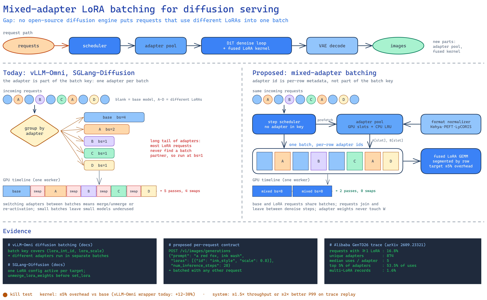
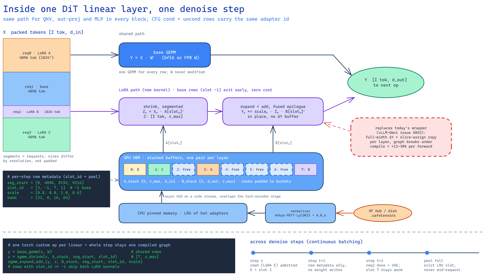
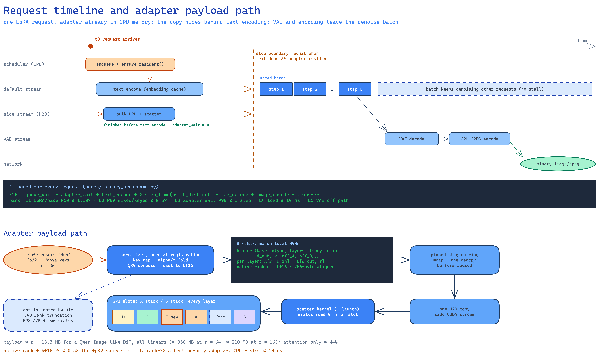

# loramux

Put requests that use different LoRA adapters into the same diffusion batch.

Status: design only, nothing benchmarked yet. See `HANDOFF.md` for the full spec and `BENCH_CHECKLIST.md` for the benchmark plan.

## The problem

A LoRA adapter is a small add-on to a model's weights (`W + B·A`). Diffusion servers handle it badly when requests use different adapters:

- vLLM-Omni puts the adapter id in the batch key. Two requests with different adapters never share a batch.
- SGLang-Diffusion keeps one LoRA active per model. Changing adapters means unmerging the old one and loading the new one.

So with many adapters in play, batches stay small and the GPU sits underused. In the one public production trace we know of (Alibaba, 24 days), 16.8% of requests use a LoRA, there are 874 distinct adapters, and the median adapter is used 5 times. Adapter-keyed batching is a bad fit for that.

## The idea

Keep the base weights untouched and shared. For each linear layer, run the base matmul on the whole batch, then add each row's own LoRA correction on top. Different rows can use different adapters, or none.

Two pieces make that work:

1. **A segmented LoRA kernel.** One call applies a different `(A, B)` pair to each contiguous group of rows.
2. **A GPU adapter pool.** A fixed number of slots on the GPU hold adapters in stacked buffers. Adapters not in a slot wait in pinned CPU memory and are copied in the background.

The kernel idea already exists for LLMs (Punica, S-LoRA, vLLM's Triton LoRA ops). What is missing for diffusion is the rest: DiT layer shapes, classifier-free guidance (CFG) doubling the batch, `torch.compile` compatibility, the many LoRA file formats, and a scheduler that doesn't split batches by adapter.

## Diagrams

### System view



The top half shows today's behavior: requests are grouped by adapter, so each group becomes its own small batch. The bottom half shows the proposal: one batch holds requests with any mix of adapters. The panel at the side lists the evidence and the pass/fail bars for the kill test.

Request path:

```
client -> scheduler -> adapter pool -> DiT denoise loop -> VAE -> image
                           ^
                  LoRA file (Hub or disk) -> format normalizer
```

The scheduler admits a request into the running batch once its adapter is on the GPU. The batch key is model, resolution, step count and CFG on/off. It does not include the adapter.

### Inside one linear layer



For one linear layer in one denoise step:

1. The batch's tokens are flattened to `X` with shape `[T, d_in]`. Each request owns a contiguous range of rows (a segment).
2. The base layer computes `Y = X·Wᵀ` for everything. This is the normal fast matmul.
3. **Shrink:** for each segment, `Z = X · Aᵀ` using that segment's adapter. `Z` is small (rank 16 to 64 columns).
4. **Expand-add:** `Y += scale · Z · Bᵀ`, written in place. Segments with no adapter (slot −1) skip both steps.
5. The adapter's weights come from the pool: per layer, one stacked buffer for all `A`s and one for all `B`s, indexed by slot.

Details that matter:

- `alpha/r` is folded into `B` once when the adapter is loaded. The runtime `scale` is only the user's strength. Mixing these up is a common bug, so there is a test that pins it.
- Fused QKV layers are handled when the adapter is loaded: the three `A`s are stacked and the three `B`s are placed block-diagonally. The kernel never needs to know about fusion.
- The op is registered as a `torch.library` custom op, so `torch.compile` should not add graph breaks.
- A slot is never evicted while a request is using it. Unused slots are evicted least-recently-used.

### Payload and latency



Goal: a LoRA request should take about as long as a base-model request.

- **Timeline.** When a request arrives, its adapter starts copying to the GPU on a side stream while the text encoder runs. If the copy finishes first, the adapter load adds no latency. VAE decode and image encoding run on separate streams so finished requests leave the batch immediately.
- **Latency breakdown.** Every request logs: queue wait, adapter wait, text encode, denoise steps, VAE decode, image encode, response transfer. Adapter wait is only the part not hidden behind text encoding. It is split by where the adapter was (GPU, CPU, disk, or had to be downloaded).
- **Adapter payload.** Each adapter is converted once to a single packed file: bf16, native rank (not padded), QKV already composed, `alpha/r` already folded in. Loading is one file read, one host-to-GPU copy, and one scatter kernel that writes into the slot. Optional lossy compression (FP8 storage, SVD rank truncation) is off by default and only enabled if image quality holds.

## Plan

1. **Kill test (cap 25 USD of GPU).** Check correctness, kernel overhead, and whether a simulator on a realistic trace shows a real throughput or tail-latency gain. Result: GO, GREY or NO-GO, decided against bars written down before any run.
2. **Library.** Kernels, pool, normalizer, diffusers integration, tests. Then the latency work.
3. **vLLM-Omni branch**, behind a flag, only if the kill test is GO.

The bars are in `HANDOFF.md` section 5. They do not change after seeing data.

## Layout

```
loramux/        package: context, metadata, layers, pool, blob, formats/, ops/
bench/          microbenchmarks, step benchmarks, trace + simulator, serve loop
tests/          pytest; GPU tests are marked `gpu`
docs/           diagrams (png, svg, editable excalidraw)
```

## Testing

Do not run the test suite on a laptop. Run it on Modal (CPU for non-GPU tests, one H100 for `-m gpu`):

```
modal run modal_app.py::cpu_tests
```

## Limits in v1

Single GPU only. No LoKr, LoHa or DoRA (rejected, or SVD-approximated behind a flag). No ControlNet or IP-Adapter. One resolution per batch. Step caching (Cache-DiT, TeaCache) is off in mixed batches.
